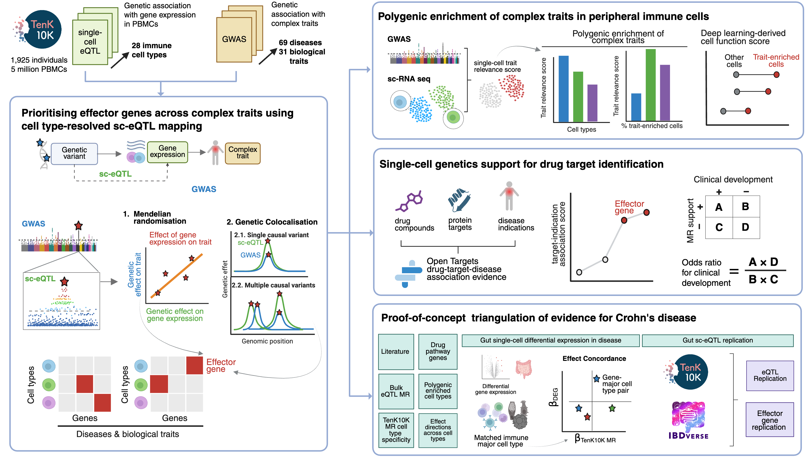

# TenK10K Phase1 effector genes identification manuscript


[](https://www.medrxiv.org/content/10.1101/2025.08.28.25334614v4)


## Study design


## Overview

This repository contains the code behind the manuscript *Single-cell genetics
identifies cell-type-specific effector genes across complex traits and
diseases*. It holds code and small metadata tables only, with no data or
results. Its two parts are:

- **Analysis pipelines** (`workflow/`, `sensitivity/`). These are Snakemake pipelines that turn GWAS and single-cell eQTL summary statistics into Mendelian randomisation (MR), sensitivity, colocalisation, MAGMA, scDRS, enrichment and Open Targets results. They need the TenK10K data and an HPC cluster.
- **Display items** (`scripts/`). These are the R, Python and Typst scripts that turn those results into every figure and table in the manuscript. Each item has a single command that rebuilds it from summary-level inputs.

## Contents

| Path | Contents |
|---|---|
| `scripts/0-preprocess/` | Shared loader for the summary statistics, and helpers to fetch them |
| `scripts/1-overview/` … `scripts/8-crohns/` | One folder per Results subsection (see the table below); each has a README listing its scripts |
| `scripts/util/` | `write_table()`, which writes the supplementary tables |
| `scripts/Snakefile`, `Makefile` | Link every display item to the scripts and inputs that produce it |
| `workflow/` | Main analysis pipeline, plus the conda environments in `workflow/envs/` |
| `sensitivity/` | MR sensitivity pipeline ([IVW-MR](https://mrcieu.github.io/TwoSampleMR/index.html), [MR-link-2](https://github.com/adriaan-vd-graaf/mrlink2)) |
| `metadata/` | Cell types, traits, trait categories, gene annotation, supplementary-table column labels |
| `config/` | Settings for the display items (`figures.yaml`, `figure_inputs.txt`) and pipeline file maps |
| `figures/biorender/` | BioRender artwork for Fig. 1 |

## Reproducing the display items

### Quick start

You need [conda](https://github.com/conda-forge/miniforge), and about 32 GB
of memory and 10 GB of disk space.

```bash
# 1. Install Snakemake (once); activate it whenever you run make
conda create -n snakemake -c conda-forge -c bioconda 'snakemake>=9'
conda activate snakemake

# 2. Get the code and the data (once)
git clone https://github.com/powellgenomicslab/tenk10k-effector-genes.git
cd tenk10k-effector-genes
make data

# 3. Build a figure -> figures/fig-m2.pdf, figures/fig-m2.png
make fig-m2
```

`make all` builds every figure and table, and `make list` shows each target
with its caption. To run several scripts at once, add `CORES=N`. Each script
can use up to about 16 GB of memory, so choose N no larger than your memory in
GB divided by 16 (for example `CORES=4` with 64 GB). Rebuilding everything takes about
an hour of computing: on NCI Gadi, `make all` with `CORES=4` finished in 16
minutes and used at most 50 GB. The first build
installs a pinned R 4.4.1 conda environment, which takes several minutes;
later builds reuse it.

> [!NOTE]
> The data download will be released with the published manuscript. Until
> then, `make data` reports that it is not yet available.

### Using the container instead of conda

If [Apptainer](https://apptainer.org) (formerly Singularity) is available, as
on most Linux workstations and HPC systems, you can run the scripts inside a
ready-made container image instead of installing the conda environment. Add
`SDM="conda apptainer"` to any build:

```bash
make fig-m2 SDM="conda apptainer"
```

The first such build downloads the image (1.5 GB); later builds reuse it.

### Running on an HPC cluster

On most clusters, compute nodes have no internet access and login nodes are
not meant for heavy work. Split the work in two:

1. **Download**, once, wherever your site allows jobs with internet access
   (for example a data-transfer queue). Load Apptainer first if it is a
   module (`module load apptainer`), and allow 16 GB of memory:

   ```bash
   make data
   make pull          # container image only; runs no scripts
   ```

2. **Build** in a batch or interactive job on a compute node, with about
   16 GB of memory per core (here 4 cores and 64 GB):

   ```bash
   conda activate snakemake
   make all SDM="conda apptainer" CORES=4
   ```

If you set `APPTAINER_CACHEDIR`, use the same value in both steps, so that the
build finds the downloaded image. The container can see the repository
directory; if your data are linked from elsewhere (see `make link-data` under
[Options](#options)), make that path visible with
`ARGS='--apptainer-args "-B /path/to/data"'`.

**Targets:**

| Command | Builds |
|---|---|
| `make fig-mN` | Main Figure N → `figures/fig-mN.pdf`, `.png` |
| `make fig-eN` | Extended Data Figure N → `figures/fig-eN.pdf`, `.png` |
| `make fig-sN` | Supplementary Figure N → `figures/fig-sN.pdf`, `.png` |
| `make tab-sN` | Supplementary Table N → `tables/tab-sN.tsv` |
| `make figs-m`, `figs-e`, `figs-s`, `tabs-s` | All items of one kind |
| `make list` | Every target, with its caption |
| `make figures/panels/<folder>/<file>` | One output file by path, such as a panel saved on its own (e.g. `make figures/panels/1-overview/panel_b.svg`). Scripts that draw several panels write them all |

Dependencies between scripts are resolved automatically. For example, `make fig-m2` first builds the panels that Fig. 2 is assembled from. To build several items in parallel, add `CORES=N`, allowing about 16 GB of memory per core.

### Display items by Results subsection

| Results subsection | Display items | Folder |
|---|---|---|
| Landscape of causal associations between gene expression and complex traits across immune cells | Fig. 1; Supp. Figs. 1–6; Supp. Tables 1–3 | [`1-overview`](scripts/1-overview/README.md) |
| Trait-level insights from cell-type-specific effector gene mapping | Fig. 2a–b; ED Fig. 1; Supp. Fig. 7; Supp. Tables 4–5 | [`2-trait`](scripts/2-trait/README.md) |
| Assessing horizontal pleiotropy via sensitivity analyses and colocalisation | Fig. 2c; ED Figs. 2–3; Supp. Fig. 8 | [`3-pleiotropy`](scripts/3-pleiotropy/README.md) |
| Single-cell eQTL enhances identification of effector genes | Fig. 3; ED Fig. 4; Supp. Figs. 9–11; Supp. Tables 6–7 | [`4-comparison`](scripts/4-comparison/README.md) |
| Identifying disease-relevant biological pathways | ED Fig. 5; Supp. Figs. 12–13; Supp. Table 8 | [`5-pathways`](scripts/5-pathways/README.md) |
| Polygenic enrichment reveals trait-relevant immune cell types | Fig. 4; ED Fig. 6; Supp. Figs. 14, 21–24; Supp. Tables 9–10 | [`6-polygenic`](scripts/6-polygenic/README.md) |
| Single-cell MR supports drug target discovery | Fig. 5; ED Fig. 8; Supp. Fig. 16; Supp. Tables 11–15 | [`7-drug`](scripts/7-drug/README.md) |
| Triangulation of evidence prioritises effector genes for Crohn's disease | Fig. 6a–c; ED Figs. 9–10; Supp. Figs. 17, 25 (raw data only); Supp. Tables 16–21 | [`8-crohns`](scripts/8-crohns/README.md) |

Some items are not produced by code in this repository:
- **Fig. 1a** is BioRender artwork, provided in `figures/biorender/`.
- **Fig. 6** is assembled by hand from panels a–c (`make fig-m6`) and panel d.
- **Fig. 6d and Supp. Figs. 18–19** come from the [`TenK10K_causal_inference_vs_IBDverse`](TenK10K_causal_inference_vs_IBDverse) submodule.
- **ED Fig. 7 and Supp. Fig. 15** come from scDeepID, in a separate repository.
- **Supp. Fig. 20** (genes tested per cell type) is not yet linked to a script.

### Options

- **Your own software.** `make fig-m2 SDM=` uses the R and Python already on your `PATH`. The packages needed are listed in `workflow/envs/figures.yaml`.
- **Rebuilding the container image.** The image is built from the `Dockerfile`, which `make dockerfile` regenerates from the conda environments. Publish each rebuild under a new tag and update `container:` in `config/figures.yaml`: Snakemake caches images under a name derived from the tag, so a rebuilt image pushed under an existing tag is ignored wherever the old one has been downloaded.
- **Existing results tree.** If you already have the results tree, run `make link-data DATA_DIR=/path/to/results/root` instead of `make data`. It links each input file listed in `config/figure_inputs.txt` and does not modify the source.
- **Raw-data steps.** The Crohn's colon UMAPs (Supp. Fig. 25) read raw single-cell data, which is not shared; where it is available, add `ARGS="--config restricted=true"`. The LD behind the GPX1 and JAZF1 locus plots is computed from individual-level genotypes by the analysis pipeline in `workflow/`; only the resulting r² values are in the download.

### Regenerating the summary statistics

The pipelines in `workflow/` and `sensitivity/` need the TenK10K individual-level data and run on NCI Gadi under PBS; see [`workflow/README.md`](workflow/README.md) and [`sensitivity/README.md`](sensitivity/README.md). They are provided so that every step from raw data to summary statistics is documented. To check that a pipeline parses off the cluster:

```bash
snakemake --snakefile workflow/snakefile --workflow-profile none --list-rules
```

## Data Availability

The data needed to rebuild the display items will be deposited on Zenodo as a
dataset with its own DOI, separate from this code's release, following
manuscript publication. `make data` downloads the archive and checks every file
against its checksum. The archive's `INVENTORY.tsv` lists each file with its
source and licence. [`RELEASING.md`](RELEASING.md) describes how the code and
data releases are linked. The sc-eQTL summary statistics are released separately as described in the main [TenK10K phase 1 sc-eQTL mapping study (Cuomo et al.)](https://www.medrxiv.org/content/10.1101/2025.03.20.25324352v2).

Not shared:
- Individual-level single-cell expression and genotypes of the TenK10K donors

Third-party data (please refer to the original publications for access):
- [Kong et al. 2023 single-cell transcriptomics from colon tissues](https://pubmed.ncbi.nlm.nih.gov/36720220/)
- [AIFI Immune Health Atlas (Gong et al. 2025)](https://doi.org/10.1038/s41586-025-09686-5)
- [IBDverse single-cell transcriptomics atlas (Alegbe T, Harris BT, et al.)](https://doi.org/10.6019/S-BSST2922)

## Citation

If you use this code or data in your research, please consider citing

**Preprint**:

Henry, A., Senabouth, A., Tyebally, R., et al. Single-cell genetics identifies cell type-specific causal mechanisms in complex traits and diseases. medRxiv 2025.08.28.25334614 (2025) doi:10.1101/2025.08.28.25334614

[medRxiv link](https://www.medrxiv.org/content/10.1101/2025.08.28.25334614v2)

See *References* section in the manuscript for additional citations of methods and data sources.

## Acknowledgments

- TenK10K study members and contributors
- Data providers and consortia (eQTLGen, IBDverse, GWAS consortia, STRING, Open Targets)
- Software developers & maintainers (Snakemake, R/Bioconductor, R Tidyverse, Python scientific computing ecosystem, MAGMA, scDRS, PLINK)
- Computational resources and support teams (Australia National Computing Infrastructure, Garvan Institute Data Science Platform)
